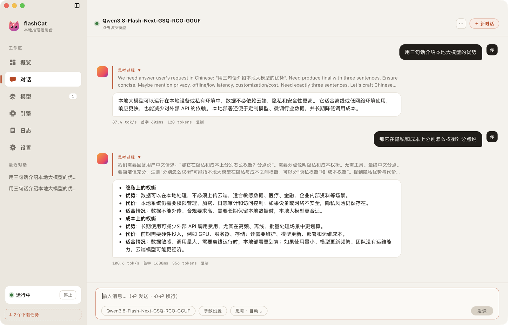
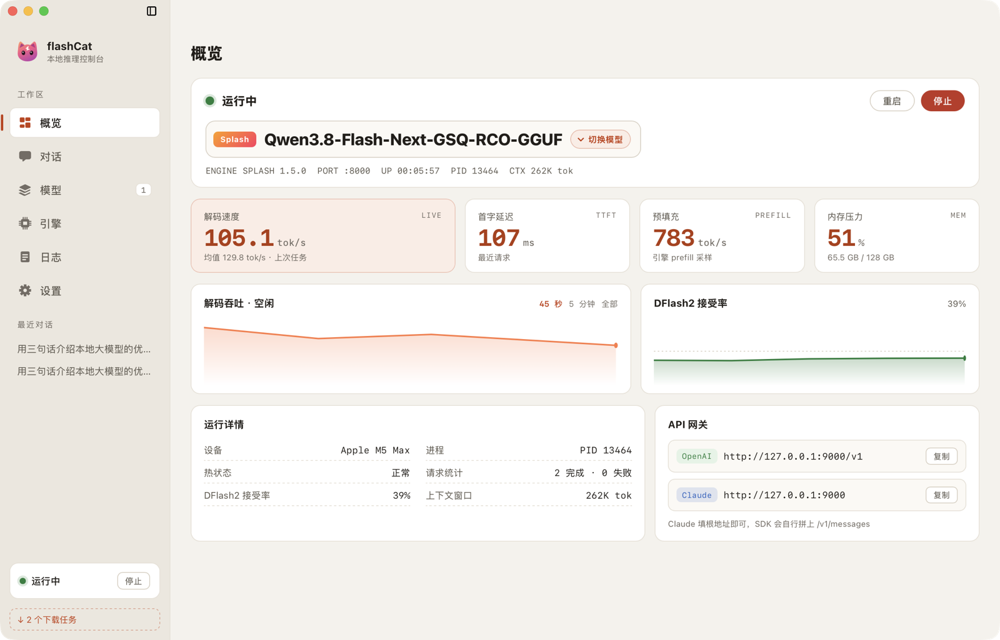
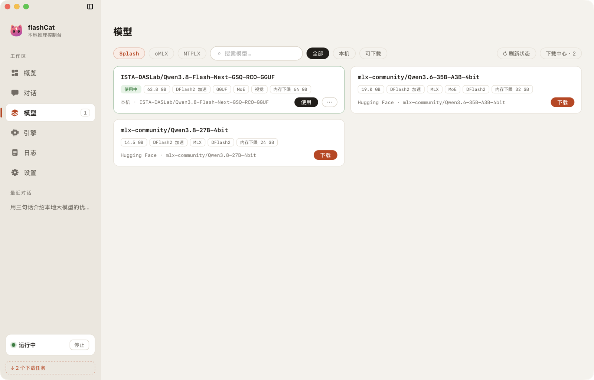
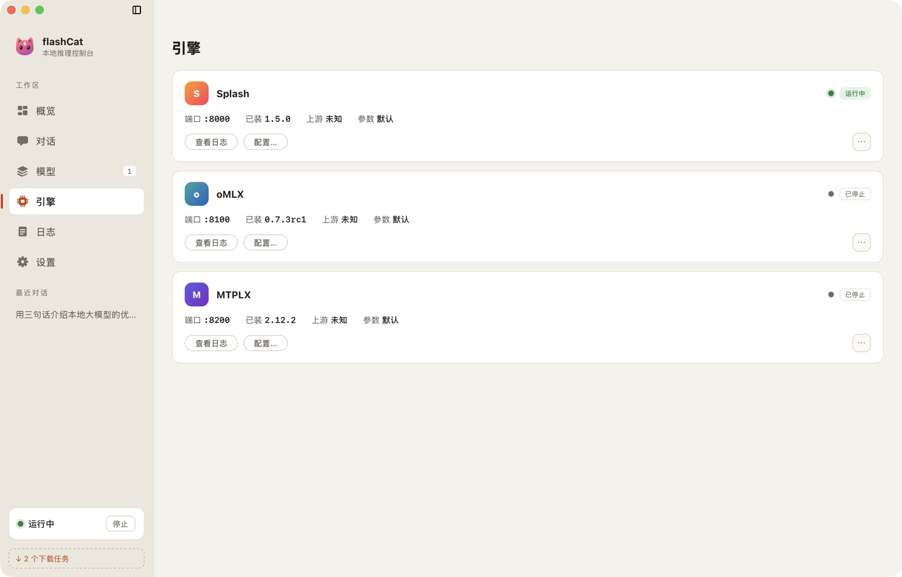
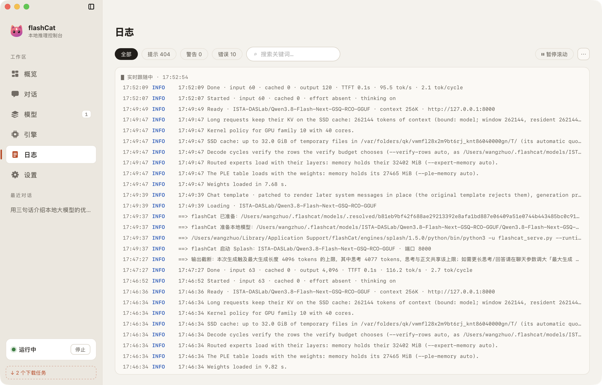
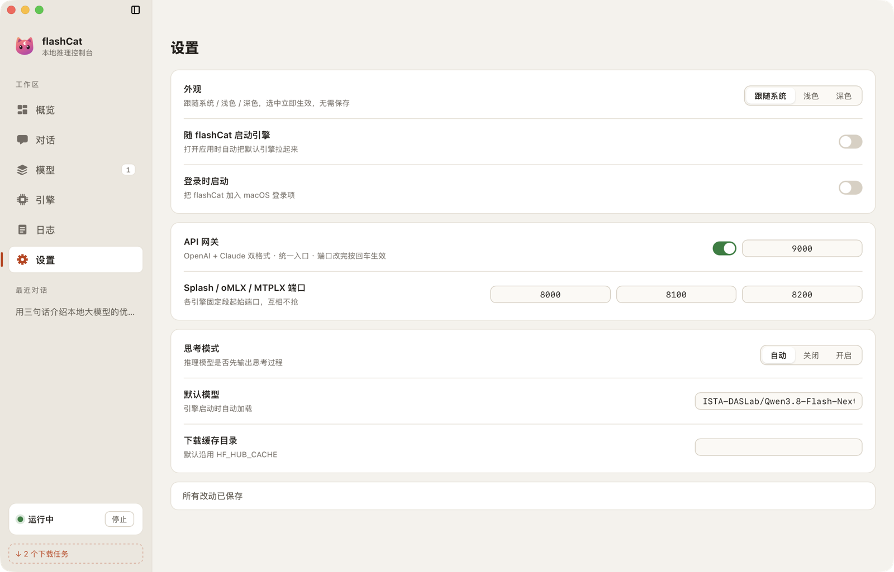

# flashCat

**Mac 上的本地大模型控制台。** 在同一个窗口里装引擎、下模型、聊天，并把它变成
一个可以给自己任何 AI 客户端用的本地接口。

不需要敲命令行，不需要为每个引擎记一套参数；打开就能用，
需要接别的工具时它就是一个 `http://127.0.0.1:9000/v1` 这样的地址。



---

## 它能做什么

- **三个引擎，一个界面。** Splash、oMLX、MTPLX 各自有自己的端口和日志，
  在这里统一切换、启动、停止，不用开三个终端。
- **模型在应用里下载。** 每个引擎都配好三档 Qwen 模型，点一下就能下载、加载、切换，
  不用自己去 Hugging Face 找仓库、也不用处理格式对不对。
- **自带 API 网关。** 固定地址、OpenAI 与 Claude 两种格式同时提供，
  换引擎、换端口都不用改客户端配置。
- **看得见的性能。** 解码速度、首字延迟、预填充速度、草稿接受率、内存占用、
  端口占用都在概览页实时显示。
- **日间 / 夜间皮肤。** 跟随系统、浅色、深色三档，点完立刻生效。
- **日志就在旁边。** 引擎输出实时进日志页，可以按级别过滤、搜索、暂停、清空。

## 系统要求

| | |
| --- | --- |
| 芯片 | Apple Silicon（M 系列） |
| 系统 | macOS **26.4** 或更高 |
| 磁盘 | 应用约 10 MB；每个引擎 80 MB ~ 600 MB；模型另算（每档 16 ~ 99 GB） |

## 安装

从 [Releases](https://github.com/imi4u36d/flashCat/releases) 下载最新版本：

- `flashCat-<版本>.dmg` —— 打开后把 flashCat 拖进「应用程序」
- `flashCat-<版本>.pkg` —— 双击一路安装

应用没有做公证签名，第一次打开系统会拦一下：在 Finder 里**右键点 flashCat → 打开**，
之后就不会再问。第一次打开需要联网下载引擎运行时（80 MB ~ 600 MB，取决于选哪个引擎）。

## 第一次打开

1. 启动页会列出三个引擎，选一个点下载，等它装好。
2. 装好后它就是默认引擎，窗口自动进入控制台。
3. 之后可以随时在「引擎」页装另外两个、切换默认引擎，或在「模型」页下载模型。

三个引擎的区别：

| 引擎 | 默认端口 | 适合 | 换模型 |
| --- | --- | --- | --- |
| **Splash** | 8000 | 单模型、最省事，带草稿加速 | 重启引擎 |
| **oMLX** | 8100 | 想同时常驻多个模型，换模型不停进程 | 热切换 |
| **MTPLX** | 8200 | 长上下文、多 token 预测 | 重启引擎 |

三个引擎都支持对话、流式输出、视觉模型和思考（reasoning）模型。
端口可以改，三个引擎各占一段，互不冲突。

## 界面速览

**概览** —— 引擎状态、当前模型、实时速度曲线、内存与端口占用。右侧是 API 网关地址
（OpenAI 与 Claude 各一行，都能一键复制）。



**对话** —— 内置聊天窗口。顶部可以切模型、调温度 / top-p / 最大输出、设置思考模式。
每条回复下方标着 tok/s 和首字延迟。对话记录存在本地，可以新建和翻看历史。


**模型** —— 每个引擎一份模型库，顶部先选引擎（没装的引擎也能先看它支持什么）。
装好的可以直接点「使用」，没装的点「下载」原地拉取，卡上标着体积和内存下限。



**引擎** —— 每个引擎一张卡片：状态、端口、启动参数、上游版本比对，
可以一键更新、打开安装目录、查看日志、卸载某个版本。



**日志** —— 当前引擎的实时输出，可按「全部 / 提示 / 警告 / 错误」过滤、
搜关键词、暂停滚动、清空。



**设置** —— 外观、端口、开机自启、思考模式、推理等级、默认模型、下载缓存目录等，
改完底部会出现保存条。



## 用自己的客户端连它

应用自带一个 **API 网关**，推荐所有客户端都接它：地址固定，OpenAI 和 Claude 两种格式
都能用，请求会自动转给当前运行中的引擎。

| | |
| --- | --- |
| 地址 | `http://127.0.0.1:9000/v1`（端口可改） |
| OpenAI 格式 | `POST /v1/chat/completions`（支持流式） |
| Claude 格式 | `POST /v1/messages`、`POST /v1/messages/count_tokens`（支持流式） |
| 模型列表 | `GET /v1/models` |
| API Key | 本地服务不校验，填任意字符串即可 |

OpenAI 格式：

```bash
curl http://127.0.0.1:9000/v1/chat/completions \
  -H "Content-Type: application/json" \
  -d '{
    "model": "你的模型名",
    "messages": [{"role": "user", "content": "你好"}],
    "stream": true
  }'
```

Claude 格式（SDK 里 Base URL 填 `http://127.0.0.1:9000`）：

```bash
curl http://127.0.0.1:9000/v1/messages \
  -H "Content-Type: application/json" \
  -H "anthropic-version: 2023-06-01" \
  -d '{
    "model": "你的模型名",
    "max_tokens": 1024,
    "messages": [{"role": "user", "content": "你好"}]
  }'
```

- 模型名填 `/v1/models` 里返回的名字，概览页也能看到当前加载的是哪个
- Claude 格式会完整翻译给引擎：system 提示、图片、工具调用、stop 序列、
  思考块、以及 `end_turn` / `max_tokens` / `tool_use` 等停止原因都支持
- 也可以直连引擎自己（8000 / 8100 / 8200），但地址会随引擎切换变化，
  所以一般还是接网关

## 模型

模型都在应用里下载，来源是 Hugging Face，每个引擎三档：

| 档位 | 体积参考 | 说明 |
| --- | --- | --- |
| Qwen 3.6 35B-A3B | 约 16 ~ 20 GB | 每天用最稳的一档 |
| Qwen 3.8 27B | 约 16 ~ 21 GB | 新一代，质量和速度更均衡 |
| Qwen 3.8 Flash-Next | 约 99 GB | 最重的一档，需要 128 GB 内存 |

三档在每个引擎里都用该引擎能真正跑起来的格式准备好了。应用不支持导入外部权重，
只列出这三档，避免下了却加载不了的麻烦。

磁盘上的位置（清理时用得上）：

| 内容 | 位置 |
| --- | --- |
| 应用配置、对话记录 | `~/Library/Application Support/flashCat` |
| Splash 的模型 | `~/.flashcat/models` |
| oMLX / MTPLX 的模型 | `~/Library/Application Support/flashCat/models/<引擎>` |
| 下载缓存 | 默认沿用 Hugging Face 的缓存目录，可在设置里改 |
| 日志 | `~/Library/Logs/flashCat` |

## 设置项

| 设置 | 说明 |
| --- | --- |
| 外观 | 跟随系统 / 浅色 / 深色，选中立即生效 |
| 端口 | 引擎监听端口，占用时会提示 |
| API 网关 | 双格式统一接口的开关与端口（默认 9000），改动立即生效 |
| 随 flashCat 启动 | 打开应用时自动把引擎拉起来 |
| 登录时启动 | 把 flashCat 加进 macOS 登录项 |
| 思考模式 | 自动 / 关闭 / 开启，控制思考模型是否先输出推理过程 |
| 推理等级 | 思考模式为「开启」时生效，档位由引擎决定 |
| 默认模型 | 引擎启动时自动加载哪个模型 |
| 下载缓存目录 | 模型下载缓存放哪里 |
| 恢复默认设置 | 把上面各项恢复成出厂值 |

## 常见问题

**引擎起不来，或者一直转圈？**
去「日志」页看最后几行，多半是端口被占或模型太大放不进内存。换个端口，
或者选更小的一档模型。

**下载很慢？**
oMLX 的运行时约 590 MB，Splash / MTPLX 在 80 ~ 130 MB 之间；模型从十几 GB 到 99 GB，
主要看网速。

**换模型后内存没释放？**
oMLX 可以在模型之间热切；Splash / MTPLX 换模型会重启进程，
等状态变回「运行中」再发请求。

**想让别的机器访问？**
应用只监听本机 `127.0.0.1`。需要对外提供时请自己加一层反向代理，
不要把端口直接暴露到公网。

**应用打不开，提示损坏或来自未知开发者？**
右键 → 打开；或者到「系统设置 → 隐私与安全性」里点「仍要打开」。

**模型页看不到某个引擎的模型？**
顶部可以切换引擎，没安装的引擎也能先浏览它支持哪三档。

## 卸载

1. 退出 flashCat。
2. 把 `/Applications/flashCat.app` 拖进废纸篓。
3. 想连配置和模型一起清掉，再删除：

```bash
rm -rf ~/Library/Application\ Support/flashCat ~/.flashcat/models ~/Library/Logs/flashCat
```

注意模型就存在这些目录里，删除等于把下载的权重一起删掉，执行前确认没有还想留着的模型。

## 许可

[MIT](LICENSE) © 2026 wangzhuo

三个推理引擎是各自上游项目的成果，本项目负责运行时的下载、安装与调度：
[Splash](https://github.com/incoai/splash)、
[oMLX](https://github.com/jundot/omlx)、
[MTPLX](https://github.com/youssofal/mtplx)。
模型版权归各自的发布者所有。
