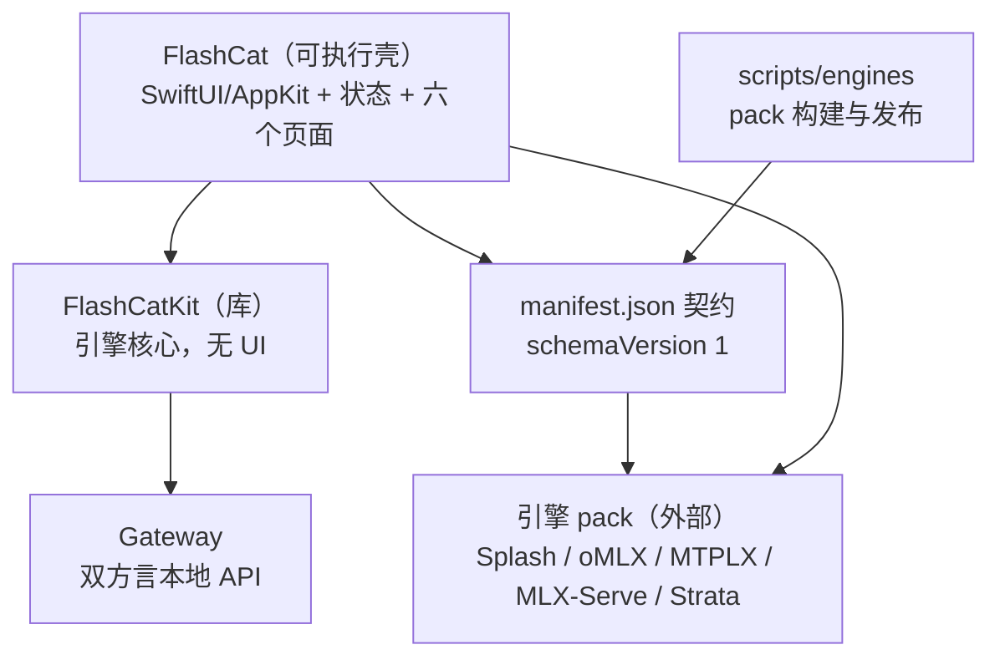

# flashCat 架构

一个 SwiftPM 工作区 + 一组构建脚本。应用本体只有两层：可测试的无界面引擎核心（`FlashCatKit`）和包着它的 macOS 壳（`FlashCat`）。表现层是壳里的六个 SwiftUI 页面，没有网页层。

## 拓扑

| 模块 | 职责 | spec |
| --- | --- | --- |
| `FlashCat` | macOS 壳：全部可变状态、进程启停、模型库、对话、菜单栏、六个原生页面 | [flashcat-app](native/Sources/FlashCat/SPEC.md) |
| `UI` | 六个 SwiftUI 页面与控制台壳 | [flashcat-ui](native/Sources/FlashCat/UI-SPEC.md) |
| `FlashCatKit` | 引擎身份/端口/能力、清单解码、状态解析、路由、包安装、启动阶段判定 | [flashcat-kit](native/Sources/FlashCatKit/SPEC.md) |
| `FlashCatKit/Gateway` | 只监听本机的双方言 HTTP 网关 | [flashcat-gateway](native/Sources/FlashCatKit/Gateway/SPEC.md) |
| `scripts/engines` | 把上游产物打成自包含运行时 pack，并生成发布索引 | [flashcat-engine-packs](scripts/engines/SPEC.md) |
| `manifest.json` 契约 | pack 与应用之间唯一的接口 | [flashcat-manifest-contract](scripts/engines/manifest-template.md) |

依赖边只有两条是真的：应用依赖 Kit（多个文件 `import FlashCatKit`）；Kit 依赖系统框架，从不反向引用应用符号。界面与状态在同一进程里，不再有跨语言桥。

## 不变量

代码已经在执行的规则，不是愿望。

1. **`FlashCatKit` 不许引 UI。** 它只 `import` `Foundation` / `Network` / `CryptoKit`。这决定它能在无窗口的测试进程里跑——`FlashCatKitTests` 有 16 个测试文件、187 个测试函数，`FlashCatTests` 另有 12 个针对壳层纯函数的用例。
2. **依赖单向。** `FlashCat` → `FlashCatKit`。Kit 里出现任何应用侧符号都是破坏。
3. **端口段不重叠。** 默认端口由引擎 descriptor/manifest 声明：`splash 8000` / `omlx 8100` / `mtplx 8200` / `mlx-serve 8300` / `strata 8400`，可用范围默认是 `defaultPort...defaultPort+19`；分配器在段内跳过被占端口，段外放弃。
4. **切换方式是能力，不是选项。** `omlx` 与 `mlx-serve` 是 `hot`，其余当前为 `restart`。应用只按 descriptor 声明的能力执行，不按引擎 id 猜测。
5. **未知枚举值降级而非失败。** 新版本 pack 带来的未知 `capability` 解成 `.chat`，未知 `modelArgument` 解成 `.name`——一个旧版应用不会因为清单多了个词就装不上。
6. **pack 不可移动。** 安装路径必须含版本号且装完不许挪（原生扩展带绝对 rpath）。`fix-pack-rpaths.sh` 在上游 wheel 把构建机路径烧进 `LC_RPATH` 时把它改写成 `@loader_path/...` 并重签名。
7. **只有用户自己的 pack 可删。** pack 有四个发现位置（环境变量覆盖、用户安装目录、应用 bundle、仓库 `vendor/engines`），但只有前两个属于用户；bundle 内的删了会破坏签名，checkout 里的是构建产物——两者都列出、只读。
8. **网关只监听回环。** 见 [flashcat-gateway](native/Sources/FlashCatKit/Gateway/SPEC.md)。
9. **清单契约是唯一接口。** 应用除了 `manifest.json` 里的字段之外不解释 pack 里的任何文件。

## 决策

**表现层回到原生。** 1.3.0 曾把六页界面换成 `WKWebView` + HTML/CSS/JS，用一条 JSON 快照桥把 Swift 状态推给网页。代价是三套语言（Swift / JS / CSS）、一份必须与源码同步的打包产物、以及 snapshot 与流式增量两套文本管线。原生重写把这层删掉：页面直接订阅 `AppState`，动作直接调用方法，视觉统一在 `Design.swift` 的 token 与组件上。视觉方向是「仪器化」的 macOS 原生语言——纯色画布、描边分层、等宽读数——而不是网页玻璃拟态。详见 [flashcat-ui](native/Sources/FlashCat/UI-SPEC.md)。

**引擎运行时永不随应用打包。** 三个原因共同决定：pack 是 GB 级（oMLX 一个就 590 MB，全塞进来应用会从 15 MB 变成数 GB，签名与分发一起变复杂）；引擎有自己的上游发布节奏，做成 pack 才能让引擎页比对上游、单独更新而不发新版应用；引擎是上游项目的成果，重分发二进制存在许可与合规顾虑，所以仓库只发构建脚本、让用户机器自己装。

**引擎差异收敛在 descriptor + adapter 两层。** descriptor 描述显示、端口、能力、模型目录布局、控制端点和遥测源；通用 OpenAI 兼容引擎可以只靠一份 manifest 接入。splash 的本地装配、Strata 的多组件安装与后台服务生命周期这类真实差异，放进各自的编译期 adapter。业务层不再为具体引擎增加散落分支。

**网关自己打点。** 引擎层没有 per-session 指标：splash 只报累计比值，oMLX 只给聚合吞吐，MTPLX 连排队数都并进在跑数。唯一知道「每个请求什么时候进来、首个 token 何时到、一共吐了多少字」的地方就是网关本身，所以会话级读数在网关侧统计。

## 发布形态

| 环节 | 脚本 | 契约 |
| --- | --- | --- |
| 编译并组装 `.app` | `scripts/build-native-app.sh` | `INSTALL=1` 装进 `/Applications`；`EMBED_PACKS` = `none`（默认，pack 由 pack-index 下载）/ `copy`（内嵌 `vendor/engines`）/ `link`（软链，仅供开发） |
| 安装到 `/Applications` | `scripts/install-app.sh` | 只保留一份副本，旧的改名备份 |
| 分发件 | `scripts/make-installer.sh` | `dist/flashCat-<版本>.pkg` 与 `.dmg` |
| 启动即登录 | `Sources/FlashCat/LoginItem.swift` | LaunchAgent `com.zhuo.flashCat` |

**最低系统版本是 macOS 26.0。** 界面依赖的 Liquid Glass 来自 macOS 26；macOS 27 的 `.tabs` 分段控件只作增强，运行时不可用时回退到 `.segmented`，因此不抬高应用下限。splash 原生引擎自身仍要求 26.4，这是引擎级门槛，其他引擎在 26.0 上照常可用。三处必须一致：`scripts/build-native-app.sh` 的 `MIN_MACOS` 写进 `Info.plist` 的 `LSMinimumSystemVersion`（默认 `26.0`），`README.md` 的系统一栏，以及 `native/Package.swift` 的 `platforms: [.macOS("26.0")]`。三点同心才站得住：前两者是用户看得见的门槛，Package.swift 是编译器与 SwiftPM 认的槛；它若停在旧版本，产物里写的是 26.0 而构建系统仍以为能跑在旧系统上，两边说法不一。

## 已知限制

- **应用层的测试仍然偏薄。** 187 个用例在 `FlashCatKit`，`FlashCatTests` 只覆盖从壳层沉淀出来的纯函数（`LogStore` 的尾部切片、快照的数值清洗、进程树的存活探测）。`AppState` 本身（状态机、引擎启停、页面的动作分发）没有单元测试，拆分它的原因之一就是让它可测，见 `CONTRIBUTING.md`。
- **界面没有自动化测试。** 六个页面、弹窗与快捷键只能手工回归；`FlashCatTests` 覆盖的是壳层沉淀出来的纯函数。真要自动化，需要补一个能在无头环境里驱动 SwiftUI 的宿主，这不在当前范围内。
