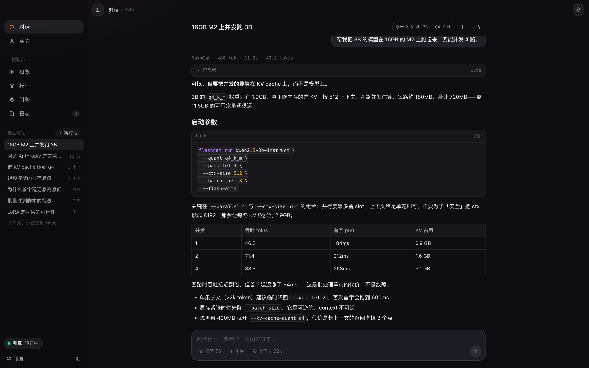

# flashCat Web 前端

原生 SwiftUI 版的界面重写（Tauri 迁移的前端产物）。目标不是"也做一个网页聊天框"，
而是把 `native/Sources/FlashCat/UI` 那套**仪器化**视觉语言——纯色画布、描边分层、等宽读数——
用 CSS 一比一搬过来，让壳换了、眼睛认得的还是同一个东西。



## 跑起来

```bash
pnpm install
pnpm dev        # http://127.0.0.1:1420
pnpm build      # tsc --noEmit && vite build → dist/
```

`dist/` 就是 Tauri 壳的 `frontendDist`。现在还不需要 Rust：`pnpm dev` 在浏览器里就能看全部界面。

开发期 URL 参数（无头截图逐页核对用）：

| 参数 | 取值 | 作用 |
| --- | --- | --- |
| `page` | `overview` `chat` `models` `engines` `logs` `settings` `lab` | 直接打开某页 |
| `theme` | `dark` `light` | 首帧生效，不走过渡 |
| `sidebar` | `0` | 侧栏收起 |
| `demo` | `stream` | 自动发一轮对话，看流式渲染 |

## 目录

```
src/
  tokens.css      设计 token：native/Sources/FlashCat/UI/DesignSystem.swift 的 DS 的 CSS 表达（唯一需要与 Swift 同步改的文件）
  app.css         外壳、侧栏、标题栏、概览、对话、Markdown、输入卡的全部样式
  icons.tsx       SF Symbols 的手绘等价物（16×16、1.4 描边），不引图标库
  App.tsx         外壳 + 侧栏 + 标题栏 + 页路由 + 主题
  chat.ts         假流式引擎：思考块先涨、正文按 token 推进、收尾结算 tok/s
  pages/Overview.tsx   概览页（模型带 / 5 格 KPI / 60s 吞吐 / 网关卡 / 运行时卡 / 最近请求）
  pages/Chat.tsx       对话页（720 栏、用户气泡、思考块、流式 Markdown + 光标、输入卡）
  components/md.tsx    轻量 Markdown（段落 / 标题 / 列表 / 围栏代码 / 表格 / 引用 + 四类着色）
  data/mock.ts         假数据
docs/preview/    明暗两套截图
```

## token 从哪来

`tokens.css` 里的每个值都是从 `native/Sources/FlashCat/UI/DesignSystem.swift` 的 `enum DS` 抄的，
深浅两套并列。**这是唯一需要两边同时改的文件**——改色、改圆角、改间距，Swift 与 CSS 一起动，
否则两版界面会慢慢漂开。

| Swift | CSS | 值 |
| --- | --- | --- |
| `DS.Font` | `--f-xs … --f-display` | 11 / 12 / 13 / 15 / 22 / 30 |
| `DS.Space` | `--s-*` | 4pt 栅格 2 / 4 / 8 / 12 / 16 / 20 / 24 / 32 |
| `DS.Radius` | `--r-sm … --r-xl` | 8 / 12 / 16 / 22（同心四级） |
| `DS.Layout` | `--sidebar-w` `--titlebar-h` `--row-h` `--control-h` `--page-max` `--chat-col` | 216 / 48 / 30 / 28 / 1180 / 720 |
| `DS.Motion` | `--m-snappy` `--m-smooth` `--m-bouncy` `--m-fade` | .18 / .28 / .42 / .15 |
| `DS.Color` | `--bg` `--canvas` `--surface` `--raised` … | 深色半透明叠层 + 浅色对应值 |

玻璃只出现在导航层、标题栏、浮层与交互控件（`backdrop-filter`），正文区永远是不透明画布——
这条在原生的 `LiquidGlass.swift` 与 `architecture.md` 的视觉决策里写死，这里照办。

## 已经对位的部分

| 原生 | Web |
| --- | --- |
| `ConsoleShell.swift`（ZStack + 侧栏 216 + 竖分隔） | `App.tsx` 的 `.app` 网格 |
| 侧栏 workspace / 「控制台」分组 / 最近对话 / 灵动岛 | `Sidebar`，导航行高 32、图标列 18、选中底 8% |
| `AppState.swift:11-37` 的 `enum Page` | `type Page`，七个页面同一套图标语义 |
| `OverviewPage.swift`（hero → 5 格 KPI → 双栏 → 最近请求） | `pages/Overview.tsx`，区域间距 12 |
| `ChatPage.swift`（720 栏、思考块、Markdown、输入卡） | `pages/Chat.tsx` + `components/md.tsx` |
| `MarkdownView.swift`（块级解析 + 流式节拍） | `md.tsx` 的 `parse()` + `caret` |
| `Theme.swift` 的 consoleText / consoleAccent | 正文色 + 强调色（KV 命中、并发槽、图表末柱） |

## 桌面壳：`src-tauri/`

Rust 侧只有三件事：读写平台信息、管一次推理的生命周期、把 token 逐帧推给前端。

```
src/
  lib.rs        注册命令、页面加载时打一行 [page] 日志
  model.rs      AppInfo / SystemInfo / EngineStatus / ModelCard / Delta（camelCase，与 TS 一一对应）
  engine.rs     Backend trait + Engine（并发槽：移动端 1、桌面 2）+ MockBackend
  commands.rs   app_info / system_info / engine_status / list_models / chat_start / chat_cancel / log_frontend
  bridge.ts     前端的类型化封装；非 Tauri 环境（浏览器里 pnpm dev）自动退回假流式
```

对话不走 HTTP：`chat_start` 开一次 run，返回 runId，之后所有增量都用 `chat:delta` 事件推回来，
`chat_cancel` 置 `AtomicBool` 让生成线程在下一个 token 处收手。这样取消是 O(1) 的，
不需要等一轮 SSE 自己结束——**不要复活 1.3.0 的 JSON 快照桥**，那套整棵快照重发与增量天然打架。

`MockBackend` 是占位的：首字 180ms、思考块 16ms/2 字、正文 18ms/3 字（移动端 26ms），
按 `max_tokens` 截断，收尾补 usage。它存在的意义是让 UI 的每一帧都能在没有模型的情况下被验证。

## 四端构建

前置：Node 22+ / pnpm 12 / Rust（**必须走 rustup**，Homebrew 的 rustc 没有交叉 target）、
macOS 上还要 Xcode 与 CocoaPods；Android 要 NDK 29（`sdkmanager "ndk;29.0.14206865"`）与 JDK 17。

```bash
cd web
pnpm install
pnpm tauri dev                 # 开发：Vite 1420 + Rust 热重编
pnpm tauri build               # 桌面安装包（本机架构）
pnpm tauri build --target universal-apple-darwin   # macOS 通用包

pnpm tauri android init        # 一次性：生成 gen/android
pnpm tauri android build --apk --debug --target aarch64
pnpm tauri android dev         # 装到已连接的设备/模拟器

pnpm tauri ios init            # 一次性：生成 gen/apple（需要 pod）
pnpm tauri ios build --debug --target aarch64-sim
pnpm tauri ios dev             # 真机调（首次会提示选签名团队）
```

产物位置：

| 平台 | 文件 |
| --- | --- |
| macOS | `src-tauri/target/release/bundle/macos/FlashCat.app`、`bundle/dmg/*.dmg` |
| Windows | `src-tauri/target/release/bundle/nsis/*-setup.exe`、`bundle/msi/*.msi` |
| Linux | `src-tauri/target/release/bundle/deb/*.deb`、`bundle/appimage/*.AppImage` |
| Android | `src-tauri/gen/android/app/build/outputs/apk/**/*.apk` |
| iOS | `src-tauri/gen/apple/build/**/*.app`（模拟器）/ 真机要 `--export-method development` |

Android 出**可分发**的包（release + 签名）：

```bash
pnpm tauri android build --apk --target aarch64
./scripts/sign-android.sh                 # zipalign + 签名 + 校验
# → src-tauri/gen/android/app/build/outputs/apk/universal/release/*-signed.apk
```

签名材料放 `~/.flashcat-keys/env.sh`（`FLASHCAT_KS` / `FLASHCAT_KS_ALIAS` / `FLASHCAT_KS_PASS`），
脚本读不到就退回 debug 签名（能装，但不能上架）。**keystore 与口令都不要进仓库**。
体积参考：debug 132MB（未 strip 的 `.so`），release 签名后约 6MB。

## 移动端

手机不是把桌面版缩小，而是同一套壳换一种密度（`app.css` 末尾的 `html[data-mobile="true"]` 整段，
桌面宽度一条都不命中）：

- **侧栏变抽屉**：`position: fixed` + `translateX(-102%)`，点汉堡或左缘滑出，`.scrim` 遮罩点一下收回，
  跳页自动收；`window-controls`（红黄绿三颗）只在 Tauri 桌面壳里渲染。
- **概览重排**：5 格连体 KPI → 2 列卡片（最后一格跨两列），双栏 `.mid` → 单列，表格横向滚动。
- **对话满宽**：正文 15.5px/1.62，`.composer-wrap` 贴底部安全区，`.chat-head` 里的模型徽标隐藏
  （393pt 宽会折行）。
- **安全区**：`index.html` 的 viewport 带 `viewport-fit=cover`，标题行 `height: calc(52px + env(safe-area-inset-top))`；
  没有 `viewport-fit` 时 `env(safe-area-inset-*)` 恒为 0（iOS 尤其明显）。
- **外观跟随系统**：手机上 `data-theme` 取 `prefers-color-scheme`（不落 localStorage、不显示切换按钮），
  这样 Android `enableEdgeToEdge()` 按系统决定的**状态栏图标明暗**永远和界面深浅一致。
  桌面仍可手动切并在 localStorage 里记住。
  主题色与系统栏也在原生侧对齐：`res/values/themes.xml` 与 `values-night/themes.xml`
  都设 `windowBackground=@color/flashcat_canvas`、状态栏/导航栏透明、`windowLightStatusBar=false`。
  （改 `themes.xml` 时别在 XML 注释里写 `--`，AAPT 会直接失败。）

本地跑移动端：

```bash
# Android 模拟器
emulator -avd flashcat -no-window -no-audio -no-boot-anim -gpu swiftshader_indirect &
adb wait-for-device && adb install -r <apk> && adb shell am start -n dev.flashcat.desktop/.MainActivity
adb exec-out screencap -p > /tmp/android.png

# iOS 模拟器
xcrun simctl boot <udid>
xcrun simctl install <udid> src-tauri/gen/apple/build/arm64-sim/FlashCat.app
xcrun simctl launch <udid> dev.flashcat.desktop
xcrun simctl io <udid> screenshot /tmp/ios.png
xcrun simctl ui <udid> appearance light   # 或 dark
```

截图（同机位、深浅两套）：`docs/preview/07-android-dark.png`、`08-android-light.png`、`10-ios-dark.png`、`11-ios-light.png`，抽屉展开态见 `09-android-drawer.png`。

Windows 的包**只能**在 Windows 上构建（Tauri 不支持交叉编译到 MSVC），
所以放在 `.github/workflows/app-release.yml` 的 windows-2025 作业里出；
iOS 真机包需要开发证书与描述文件，本地首次跑 `pnpm tauri ios dev` 由 Xcode 自动签名，
CI 里则要配 `APPLE_CERTIFICATE` / `APPLE_PROVISIONING_PROFILE` 一类 secrets。

## 一个协议上的坑（已踩）

Rust 侧 `Delta` 是带 tag 的枚举：

```rust
#[serde(tag = "kind", rename_all = "camelCase", rename_all_fields = "camelCase")]
pub enum Delta { Text { run_id: String, delta: String }, ... }
```

容器级的 `rename_all` 只改变**变体名**（`Text` → `text`），**不改字段名**。
少了 `rename_all_fields` 时 JSON 里是 `run_id`，而前端读 `d.runId` 得到 `undefined`：

- 第一条 delta 把 `runId` 记成 `undefined`，看起来还能继续；
- 等 `chat_start` 的 Promise 解析、把真实的 `runId` 写回去之后，**后续每一条 delta
  都会因为 `runId` 不匹配被丢掉**——界面就停在「生成中 · 0 tok」，不报错。

这类「静默丢事件」在没有 devtools 的手机上极难看出来，所以现在 `chat.ts` 里
不匹配时会 `console.warn` 一次。写事件协议时，字段名的 camelCase 一定要用
`rename_all_fields`（或逐字段 `#[serde(rename)]`）显式声明。

## 日志

被 LaunchServices 拉起的 `.app`、以及手机端，都没有能看 stdout 的终端，所以日志同时落盘：

| 平台 | 路径 |
| --- | --- |
| macOS | `~/Library/Logs/dev.flashcat.desktop/flashcat.log` |
| iOS | 沙盒 `Library/Logs/flashcat.log` |
| Android | `files/logs/flashcat.log`（`adb shell run-as dev.flashcat.desktop cat files/logs/flashcat.log`）|

一次正常启动应该看到四行：`boot …` → `page Started` → `page Finished` → `shell ready · <platform>/<arch> · v… · backend=… state=…`。
少了 `page Finished` 说明前端资源没进包（`frontendDist` 或 CSP 的问题），
少了 `shell ready` 说明 IPC 没通（命令没注册 / capability 没放行）。
桌面端只想看一次：`pnpm tauri dev` 的标准输出里也有同样的行。

## 现在是假的

- **推理**：`MockBackend` 是定时器，不是模型。接真后端时实现 `Backend::generate` 即可，
  上层（命令、事件、并发槽、取消、`Delta` 协议）都不用动。
- **概览 / 模型 / 引擎 / 日志**：数字与列表还是 `data/mock.ts` 的常量；模型页的五个条目会逐步
  换成 `list_models` 的真实输出。
- **主题**：桌面手动切换并存 localStorage；手机跟随系统（无手动开关），已接。
- **字体**：`--font-mono` 依赖 `SF Mono`；Windows 上要换成随包内置的 JetBrains Mono。

## 下一步

1. 把 `MockBackend` 换成真的 llama.cpp（见 `docs/mobile.md` 的编译与绑定方案）。
2. 模型下载器：断点续传 + 校验 + 落 `filesDir/models`（iOS 是 Application Support），首次启动引导。
3. 概览接真实指标（吞吐、TTFT、内存），日志页接 `tracing` 环形缓冲。
4. Windows 的首个可用包走 CI，本地不折腾。

